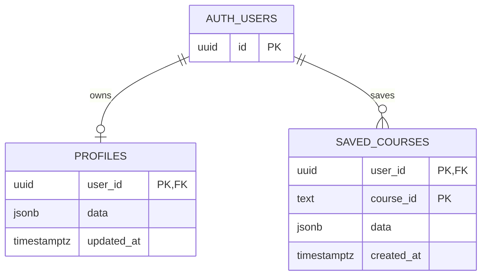

# 어디가지 DB 설계도

기준일: 2026-10-14. [supabase/schema.sql](../supabase/schema.sql)과 서버의 데이터 접근 코드 기준이다. 운영 DB에 SQL이 실제 적용됐는지는 이 문서만으로 확정하지 않는다.

## 물리 ERD

auth.users는 Supabase 관리 테이블이다. 앱은 비밀번호를 별도 테이블에 저장하지 않는다.

## 테이블 정의

| 테이블·컬럼 | 타입 | 제약·기본값 | 의미 |
|---|---|---|---|
| profiles.user_id | uuid | PK, auth.users(id) FK, 삭제 cascade | 사용자별 한 행 |
| profiles.data | jsonb | NOT NULL, 기본 {} | 프로필·취향 |
| profiles.updated_at | timestamptz | NOT NULL, now() | 서버 갱신 시각 |
| saved_courses.user_id | uuid | 복합 PK, FK, 삭제 cascade | 코스 소유자 |
| saved_courses.course_id | text | 복합 PK, NOT NULL | 생성한 코스 ID |
| saved_courses.data | jsonb | NOT NULL | 저장 시점 코스 스냅샷 |
| saved_courses.created_at | timestamptz | NOT NULL, now() | 최초 저장 시각 |

동일 사용자·course_id 저장은 upsert한다. 같은 장소 조합도 새 추천이면 다른 course_id가 생성되므로 장소 조합의 중복 저장을 DB가 금지하지 않는다.

## JSON 내부 구조

프로필 data: name, age, gender, personality, mbti, interests, location. 이름 최대 20자, 관심사 최대 6개 등 입력 정제는 서버에서 수행한다. age는 문자열이며 숫자 DB 컬럼이 아니다.

코스 data: id, title, conditions, places, totalCost, minutes, end, demo, estimated와 선택적인 label, concept, environmentLabel. conditions는 지역·목적·예산·시간·시작 시각·실내외·분위기·이동수단을 담는다. places는 장소 ID·이름·분류·비용·체류·좌표·주소·방문 시각·이동 추정치를 포함하는 JSON 배열이다. 별도의 places 또는 courses 관계형 테이블은 현재 없다. 저장된 값은 스냅샷이므로 이후 검색 결과와 다를 수 있다.

## 권한과 접근

두 테이블 모두 RLS 사용. anon 권한 제거, authenticated에는 CRUD 허용하되 auth.uid() = user_id가 조회·수정과 삽입에 모두 적용된다. API는 본문 user_id를 신뢰하지 않고 검증된 서버 세션에서 소유자를 결정한다. profiles는 user_id 충돌, saved_courses는 user_id·course_id 충돌 기준으로 upsert한다. 계정 목록은 created_at 내림차순이며 삭제는 사용자 ID와 코스 ID를 모두 지정한다.

## DB 외 저장 및 운영 한계

| 데이터 | 위치 | 유지 범위 |
|---|---|---|
| 로그인 토큰·세션 | Node 메모리 | 재시작 시 제거; 최대 1000 세션 |
| 최근 추천 집합 | Node 또는 모바일 메모리 | 최근 18개, 조건 키 최대 100개; 재시작 시 제거 |
| 장소·경로 캐시 | 서버 메모리 | 약 5분 |
| 게스트 저장 코스 | 기기 localStorage | 해당 기기·브라우저 |

영구 추천 이력·정규화 장소 테이블·공유 코스 테이블은 현재 구현되지 않았다. 다중 서버에서 로그인과 추천 이력을 공유하려면 별도의 공유 저장소 설계가 필요하다. 기존 SQL의 PK 인덱스를 사용하며 추가 정렬 인덱스는 아직 없다.

[기능설계서](기능설계서.md) · [설계 흐름도](설계흐름도.md)
