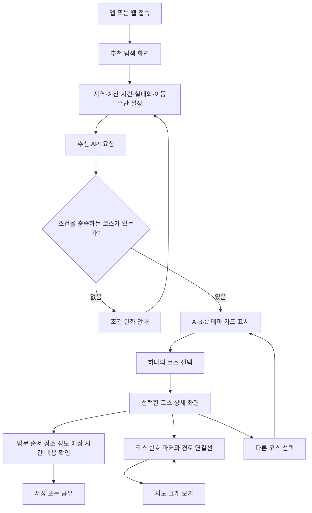
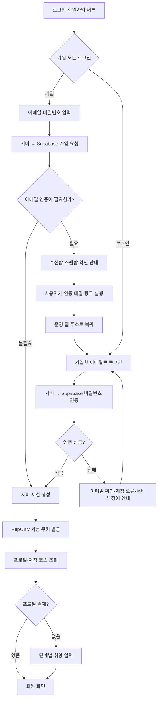
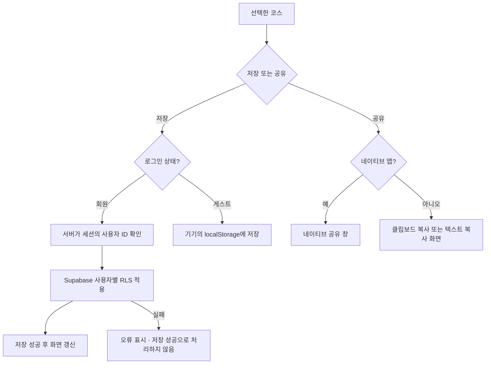
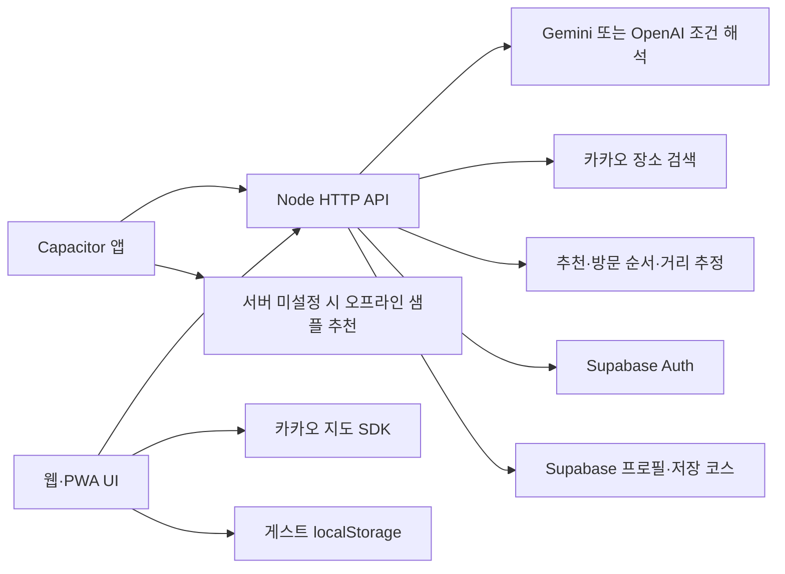

# 어디가지 설계서

## 2026-10-20 현재 상태

- 기준: GitHub `4278da0`까지 반영한 로컬 소스와 이번 화면 변경. 아래의 이전 날짜 기록은 당시 결과이다.
- 서비스 중심은 웹·PWA이며 Capacitor Android/iOS 소스도 유지한다.
- 이번 변경: 사용자 제공 노란 로고, 노란 주요 버튼·연노랑 선택 영역·따뜻한 회색 배경, 스크롤을 따라오는 지도.
- 로컬에서 실제 카카오 장소·지도·도보 경로 확인. 자동 테스트 56개 통과, 문법 검사·모바일 웹 자산 빌드 통과.
- 이번 로고·디자인·문서 변경은 아직 커밋·푸시·운영 배포 전이다. 운영 서버의 최신 상태를 오늘 재검증한 것은 아니다.
- 실제 사용자 가입 메일 → 로그인 → 저장 → 재로그인, Android/iPhone 설치와 최신 APK/IPA 검증은 남아 있다.

최종 수정: 2026-10-20. 이 문서는 사용자 피드백을 반영한 현재 소스의 설계와 검증 범위를 설명합니다. 배포 완료 여부는 인수인계 기록 및 실제 운영 서버에서 확인합니다.

## 1. 서비스와 사용자 목표

데이트·여행 조건으로 하루 일정을 추천합니다. 사용자는 많은 장소 목록을 탐색하는 대신 조건에 맞는 테마 코스를 비교하고 하나를 선택합니다. 선택한 화면에서는 해당 코스의 순서·지도·시간·예상 비용만 확인합니다.

운영 주소: https://eodigaji-app-production.up.railway.app/

공개 개발 저장소: https://github.com/hoo419/eodigaji-app

비공개 작업이전 저장소: https://github.com/hoo419/eodigaji-app-transfer

## 2. 화면 구성

| 화면 | 구성 | 주요 동작 |
|---|---|---|
| 탐색·추천 | 조건 요약, A·B·C 테마 카드, 작은 지도 안내 | 조건 변경, 코스 선택, AI 대화 |
| 선택한 코스 상세 | 방문 순서, 장소 상세, 예상 비용·시간, 해당 코스 지도 | 저장, 공유, 지도 확대, 다른 코스 선택 |
| AI 대화 | 최근 대화와 조건 변경, 추천 코스 | 조건 해석, 코스 상세 진입 |
| 저장한 코스 | 계정 또는 기기별 저장 목록 | 다시 보기, 삭제 |
| 마이페이지 | 프로필, 취향 단계 편집 | 수정, 로그아웃 |
| 인증 대화상자 | 이메일·비밀번호, 안내·오류 | 가입, 인증 후 로그인 |

추천 화면은 별도의 추가 장소 목록을 표시하지 않습니다. 지도도 코스 선택 전에는 안내를 보여주며, 선택 후에는 선택한 코스의 번호 마커와 연결선만 표시합니다. 지도에 보이는 기본 지도 POI 라벨은 지도 제공자의 배경 지도입니다.

## 3. 사용자 시나리오 흐름도

### 3.1 추천 → 선택 → 상세 → 다른 코스

### 3.2 가입 → 이메일 인증 → 로그인

### 3.3 코스 저장·공유

## 4. 시스템 구조

AI는 자연어를 조건으로 해석합니다. 서버의 추천 로직이 조회된 실제 장소로 예산·시간·실내외 제한을 만족하는 코스를 구성합니다. AI가 업체 사진·실시간 영업정보·정밀 경로를 만들어내지 않습니다.

## 5. 추천 생성과 데이터

1. 입력을 정규화하고 지역·예산·이용시간·이동수단 등 허용 범위를 검증합니다.
2. 실제 모드에서는 카카오 장소를 조회하고, 샘플 모드에서는 가상의 샘플 목록을 사용합니다.
3. 최대 12개 후보의 2~4개 장소 조합을 평가합니다.
4. 최대 4곳의 방문 순서 순열을 비교해 이동시간 추정 합계가 짧은 순서를 우선합니다.
5. 장소 비용과 체류·이동시간이 예산·시간을 넘는 조합은 제외합니다.
6. 카페·문화·공원 테마별로 해당 분류가 포함된 코스를 추천합니다. 같은 장소 집합은 중복 추천하지 않습니다.
7. 조건상 불가능한 테마를 억지로 표시하지 않습니다. 추천 수에 따라 A부터 순서대로 표시하며 최대 3개입니다. 백화점 테마는 현재 장소 검색 분류에 없어 별도 구현되지 않았습니다.

`/api/plan`은 기존의 `places`, `conditions`, `minutes`, `totalCost` 등을 유지하고 `recommendations` 배열을 추가합니다. 배열에는 코스별 `label`, `concept`, `id`, `places`, `conditions`가 있습니다. 추천마다 전체 장소 검색 목록을 반복해 넣지 않습니다.

방문 장소의 `travel`은 **직전 장소에서 현재 장소까지**의 이동시간입니다. 도착 시각은 이전 장소 체류시간과 현재 장소 이동시간을 더해 계산합니다. `travelDistance`, `travelBasis`에 추정 거리와 근거를 기록합니다.

## 6. 지도·이동시간 기준

- 코스 선택 후 해당 코스의 장소만 1, 2, 3… 번호 마커로 표시합니다.
- 선택한 장소 좌표로 지도의 범위를 맞춥니다.
- 실제 경로 조회 전의 회색 연결선은 방문 순서입니다. 실제 경로 조회 성공 시 이동수단별 경로를 별도 색으로 표시합니다.
- 지도는 탐색·상세 화면에서 스크롤을 따라옵니다. 데스크톱 상단 20px·최대 높이 420px(뷰포트에 따라 축소), 모바일 상단 8px·높이 230~300px입니다. 부모 콘텐츠의 끝에서 멈추며 확대 모드는 fixed로 유지합니다.
- 실제 좌표가 있으면 Haversine 직선거리 × 1.35를 이동 거리로 추정합니다.
- 도보는 분당 65m, 자동차는 분당 350m와 8분 여유, 대중교통은 분당 220m와 10분 여유를 사용합니다.
- 위 수치는 휴리스틱이며 횡단보도·하천·우회·시간표·교통 혼잡을 확인하지 않습니다. 상세 화면에 추정임을 표시합니다.
- 좌표 없는 샘플은 기존 고정 샘플 시간을 사용합니다. 실제 장소의 시간으로 혼동하지 않습니다.

## 7. 인증 장애와 운영 도메인

2026-10-14 로그인·가입 장애의 직접 원인은 Supabase 무료 프로젝트의 일시 중지였습니다. 중지 상태에서 프로젝트 호스트가 DNS에 존재하지 않았고, Railway의 인증 요청은 외부 연결 실패로 종료됐습니다. 프로젝트를 재개한 뒤 DNS가 복구되고 운영 서버가 정상적인 잘못된 계정 응답을 반환함을 확인했습니다.

추가로 Supabase Site URL이 `http://localhost:3000`, Redirect URLs가 비어 있는 것을 확인했습니다. 사용자 승인으로 운영 주소 `https://eodigaji-app-production.up.railway.app/`를 Site URL과 허용 복귀 주소로 설정했습니다. 실제 사용자의 인증 메일 수신·인증·로그인 전체 흐름은 별도 검증 대상입니다.

서버 `APP_ORIGIN`, Supabase Site URL·Redirect URLs, 카카오 JavaScript 웹 도메인은 배포 주소 변경 시 함께 확인해야 합니다. Gemini/OpenAI는 서버 키로 호출하므로 브라우저 복귀 주소 목록과는 역할이 다릅니다.

## 8. 설치·이미지·디자인

- 네이티브 앱, iOS `navigator.standalone`, `display-mode: standalone`에서는 설치 버튼을 숨깁니다.
- 브라우저의 `appinstalled` 이벤트 후에도 버튼이 다시 나타나지 않도록 설치 상태를 보존합니다.
- 실제 업체 사진이 제공되지 않으면 분류별 다양한 분위기 참고 이미지를 사용합니다. 실제 장소 사진이라고 표시하지 않습니다.
- 이미지 로드 실패 시 대체 카드로 표시하고, 지도 SDK 이미지에는 앱의 사진 오류 처리를 적용하지 않습니다.
- 카드·버튼·장소명·이동시간의 줄바꿈, 좁은 화면의 정렬을 보완합니다.
- 로딩·헤더에는 사용자 제공 노란 워드마크를 사용합니다. 이전 파란 로딩 화살표는 제거했습니다. 노란 주요 버튼(#ffdf00)에 짙은 글자(#29291f), 연노랑 선택 영역(#fff8cf), 따뜻한 배경(#faf9f5)을 사용합니다. 키보드 포커스는 짙은 올리브색이며 움직임 줄이기 설정을 존중합니다.

## 9. 보안·배포·검증

비밀 환경변수는 서버에만 저장합니다. 인증 토큰은 서버 세션에 보관하고 브라우저에는 HttpOnly 쿠키를 발급합니다. DB 사용자는 본문이 아닌 검증된 세션에서 결정하며 RLS를 적용합니다. 서비스 워커는 API·회원 정보를 캐시하지 않습니다.

확인 완료: 단위/HTTP 테스트 56개, `npm run check`, `npm run build:mobile`. 새 테스트는 거리별 이동시간, 불가능한 긴 이동 제외, 도착시각 합계, 테마 다양성과 조건 준수를 검사합니다.

배포 후 체크: 실제 장소로 추천 생성, A/B/C 선택, 선택한 코스 마커 수·번호, 지도 확대·복원, 다른 코스 선택, 사진 오류 대체, 데스크톱·모바일 가로 넘침, 설치 모드 버튼, 실제 가입·로그인·저장·재로그인.

Windows에서는 iOS IPA 서명 및 iPhone 실기기 검증을 수행하지 않습니다. APK·IPA가 웹 수정만으로 자동 갱신되는 것은 아닙니다. 모바일 자산 빌드와 설치 파일 빌드를 구분합니다.

## 10. 이동수단별 실제 경로 조회

선택한 코스 상세 지도에서 도보·대중교통·자동차를 전환합니다. `/api/route`는 최대 4곳의 구간을 이동수단별로 조회하고 `actual`, `legs`, `segments`를 반환합니다. 도보는 카카오 `/v2/routing/walk`, 대중교통은 `/v2/routing/publictraffic`, 자동차는 카카오모빌리티 `/v1/directions`를 사용합니다. 기존 REST 키의 권한·쿼터에 따라 실패할 수 있습니다. 성공 시 제공자가 반환한 실제 경로 좌표를 그리며 도보 녹색, 대중교통 보라색, 자동차 파란색으로 구분합니다. 대중교통 구간 안의 도보 연결도 녹색으로 표시합니다.

조회 실패 시 경로를 꾸며내지 않고 회색 방문 순서 점선과 실제 경로 미조회 안내를 표시합니다. 각 구간에는 도보·대중교통·자동차의 카카오맵 길찾기 링크를 각각 제공해 실제 보행로·환승·도로를 확인할 수 있습니다. 표시 중인 수단은 지도 확인용이며 원래 추천 일정의 수단·시간을 변경하지 않습니다. 추천 합계는 거리 기반 추정이고 상세 구간의 조회 시간과 구분합니다.

[카카오 지도 REST API](https://developers.kakao.com/docs/en/kakaomap/rest-api), [길찾기 링크](https://apis.map.kakao.com/web/guide/#routeurl), [자동차 길찾기](https://developers.kakaomobility.com/en/guide/navi-api/directions.html)를 기준으로 구현했습니다.

## 11. 배포 후 확인 결과

2026-10-14: Railway에 GitHub master 자동 배포 연결 후 배포 성공. 운영 API에서 A/B/C 카페·문화·공원 추천을 확인했습니다. 실제 도보·자동차 경로와 성수→강남 지하철 경로를 조회했습니다. 가까운 장소 사이에 대중교통 결과가 없을 때는 실제 경로 미조회 안내와 별도 길찾기 링크로 처리합니다. 브라우저에서 B 코스의 올바른 선택, 1~4 번호 마커, 확대·축소, 도보→자동차 전환을 확인했습니다. 390×844 모바일 화면은 가로 넘침과 깨진 장소 사진이 없었습니다. 설치 모드 버튼 숨김은 네이티브·PWA·iOS 상태를 모사한 회귀 테스트로 검증했습니다. 실제 iPhone 설치·가입 메일 수신·사용자 계정의 로그인/저장 전체 흐름은 아직 실기기 검증이 필요합니다.

### 테마 추천 조합 원칙 (2026-10-14)

카페·문화·공원 테마에 해당하는 장소를 한 곳 포함한다. 동일 분류의 중복 방문 조합은 제외하며, 식사를 필수 조건이나 가산점으로 우대하지 않는다. 추가 장소는 예산·이용 시간·실내외 조건을 지킨 후보 중 분위기 일치도와 이동시간으로 결정한다. 따라서 식사 장소도 다른 분류와 동등하게 선택되며, 조건에 따라 식사가 없는 코스가 추천될 수 있다.

### 코스 간 차별성과 예시 다양성

각 테마별 유효 후보를 생성한 뒤 최대 18개씩 비교해 세 코스를 함께 선택한다. 동일한 장소 집합은 금지하고 장소 중복 및 두 곳 미만 차이에 감점을 적용한다. 조건이 전체이면 카페·문화는 실내, 공원은 실외 후보부터 생성한다. 실외 분류가 부족하면 공원 포함 혼합 코스를 명시한다. 명시적인 실내외 조건은 항상 우선한다. 최근 18개 추천 집합에 감점을 주고 유효 후보의 점수에 작은 난수를 더해 반복 조회를 다양하게 만든다. 이력은 프로세스 메모리에서 조건별로 최대 100개 키만 보관하며 재시작 시 초기화된다. 후보 부족 시 코스 수를 줄이며 재방문 중복은 대안이 있을 때 억제한다.

## 상세 설계 문서

[기능설계서](기능설계서.md) · [설계 흐름도](설계흐름도.md) · [DB 설계도](DB설계도.md)

## 12. 현재 개발 계획

[최신 작업 계획](superpowers/plans/2026-10-20-current.md)을 기준으로 진행한다. 과거 프로토타입·연동·Android 계획은 해당 문서 상단의 현재 상태와 이력을 함께 읽는다. 이번 UI 변경은 DB 스키마나 API 계약을 바꾸지 않는다.
