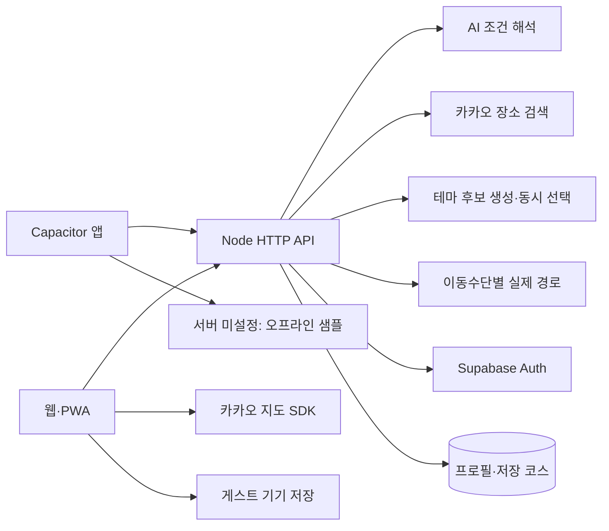
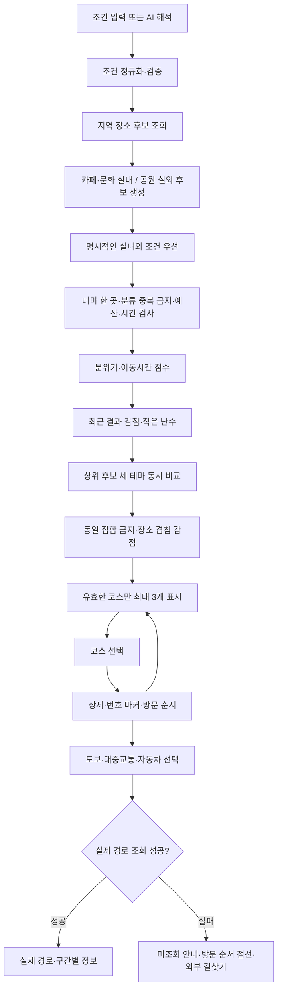
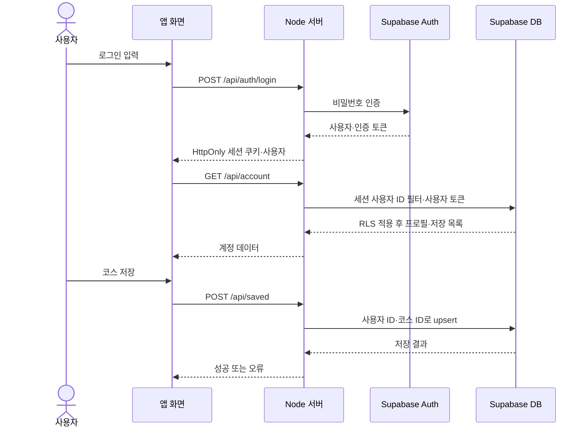

# 어디가지 설계 흐름도

기준일: 2026-10-14. 현재 코드의 처리 흐름이다.

## 시스템 구조

## 추천 및 다양성

실외 분류가 부족한 기본 추천은 공원을 포함한 혼합 후보로 대체하고 표시한다. 조건을 충족하는 후보가 없으면 조건 변경을 안내한다. 후보가 하나뿐이면 중복 카드로 채우지 않는다.

## 로그인과 저장

가입 시 인증이 필요하면 이메일 링크로 운영 주소에 복귀한 뒤 로그인한다. 게스트 저장은 서버 DB 대신 기기 localStorage를 사용한다.

[기능설계서](기능설계서.md) · [DB 설계도](DB설계도.md)
