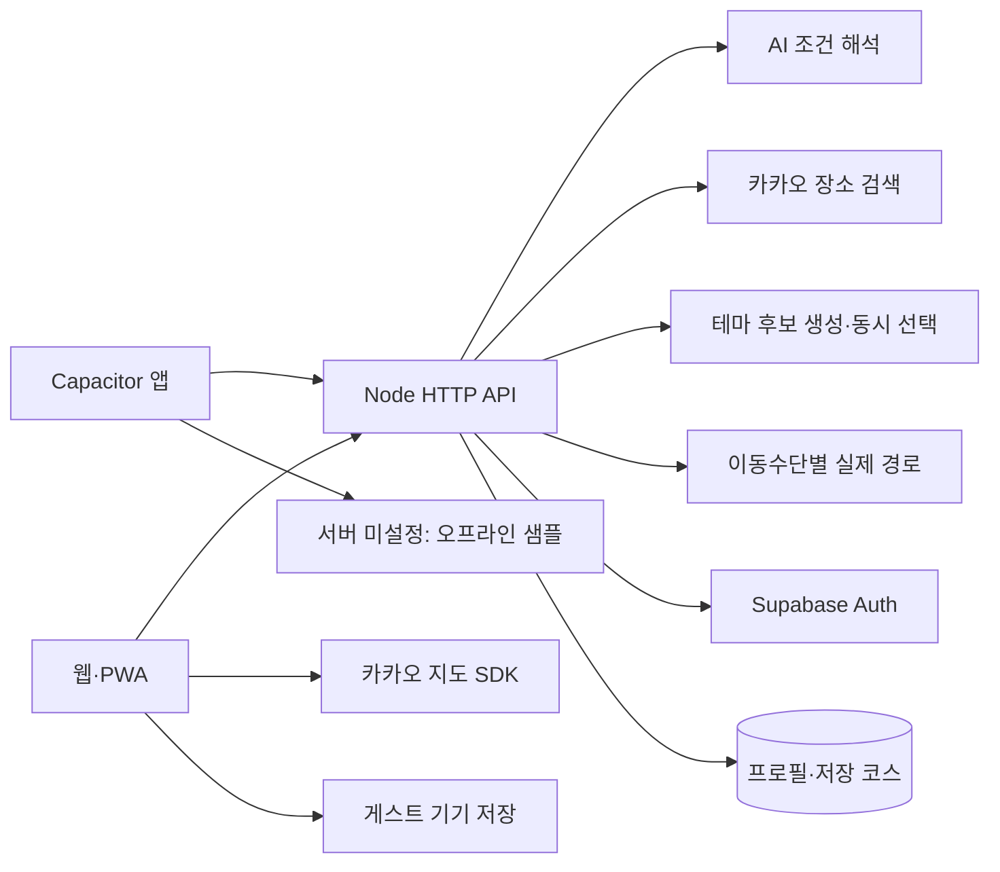
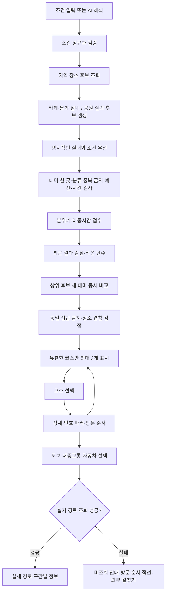
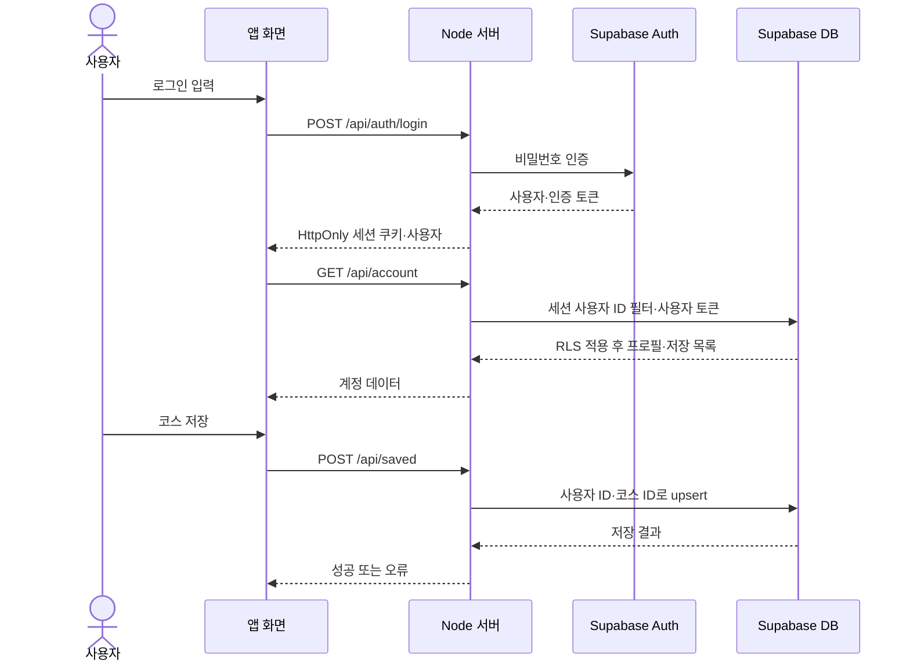
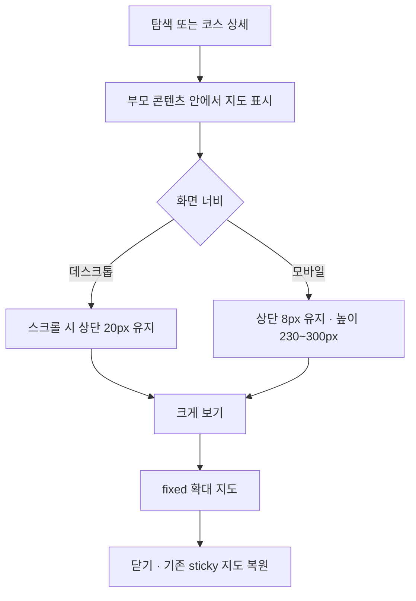
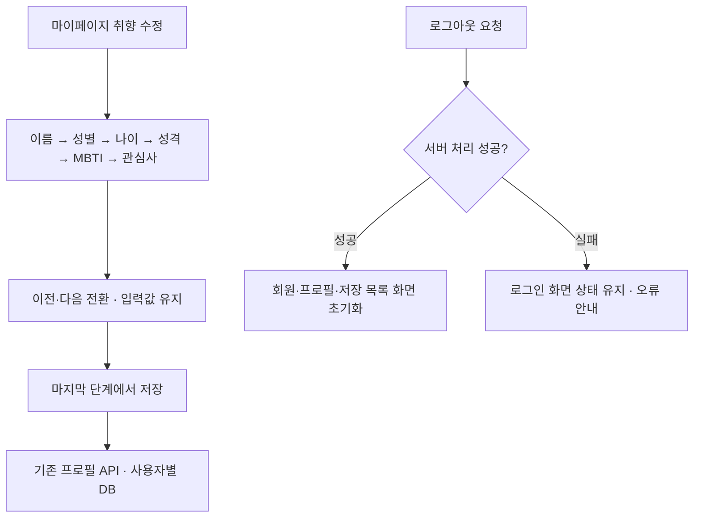

# 어디가지 설계 흐름도

## 2026-10-20 현재 상태

- 기준: GitHub `4278da0`까지 반영한 로컬 소스와 이번 화면 변경. 아래의 이전 날짜 기록은 당시 결과이다.
- 서비스 중심은 웹·PWA이며 Capacitor Android/iOS 소스도 유지한다.
- 이번 변경: 사용자 제공 노란 로고, 노란 주요 버튼·연노랑 선택 영역·따뜻한 회색 배경, 스크롤을 따라오는 지도.
- 로컬에서 실제 카카오 장소·지도·도보 경로 확인. 자동 테스트 56개 통과, 문법 검사·모바일 웹 자산 빌드 통과.
- 로고·디자인·문서 변경은 58f7eae로 커밋·푸시했다. 2026-10-20 공개 서버의 최신 로고·테마·sticky CSS와 실제 추천·Gemini 응답·지도·도보 경로를 확인했다. 전체 사용자 인증 흐름과 실기기 설치 검증은 별도이다.
- 실제 사용자 가입 메일 → 로그인 → 저장 → 재로그인, Android/iPhone 설치와 최신 APK/IPA 검증은 남아 있다.

기준일: 2026-10-20. 현재 코드의 처리 흐름이다.

## 시스템 구조

## 추천 및 다양성

실외 분류가 부족한 기본 추천은 공원을 포함한 혼합 후보로 대체하고 표시한다. 조건을 충족하는 후보가 없으면 조건 변경을 안내한다. 후보가 하나뿐이면 중복 카드로 채우지 않는다.

## 로그인과 저장

가입 시 인증이 필요하면 이메일 링크로 운영 주소에 복귀한 뒤 로그인한다. 게스트 저장은 서버 DB 대신 기기 localStorage를 사용한다.

[기능설계서](기능설계서.md) · [DB 설계도](DB설계도.md)

## 지도 스크롤과 확대

## 프로필 수정과 로그아웃

